# AIWatch BP v1.0 · 图文阅读版

[返回目录](README.md) · [原文转录](TRANSCRIPT.md)

以下图片从脱敏后的源页渲染，保留原始排版和图示。原第 12 页整页不公开；水印和末页联系方式已移除。图片宽 1920 像素，点击查看大图。

## 原第 1 页 · AIWatch

[本页文字](TRANSCRIPT.md#page-01) · [查看原尺寸图片](assets/page-01.png)

[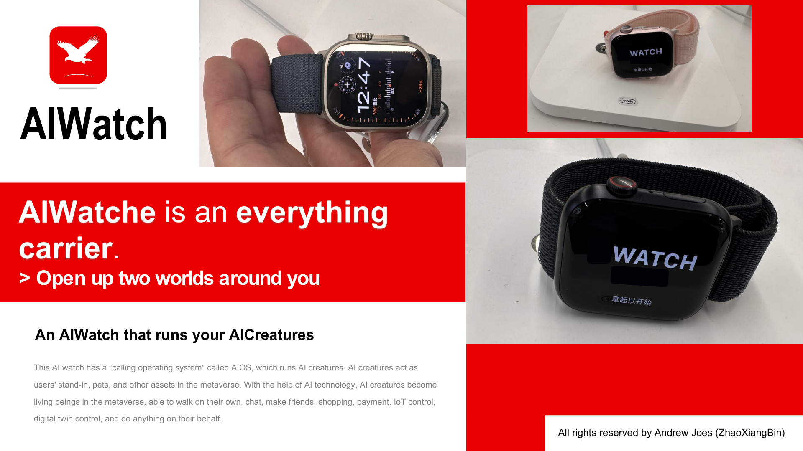](assets/page-01.png)

## 原第 2 页 · Problems

[本页文字](TRANSCRIPT.md#page-02) · [查看原尺寸图片](assets/page-02.png)

[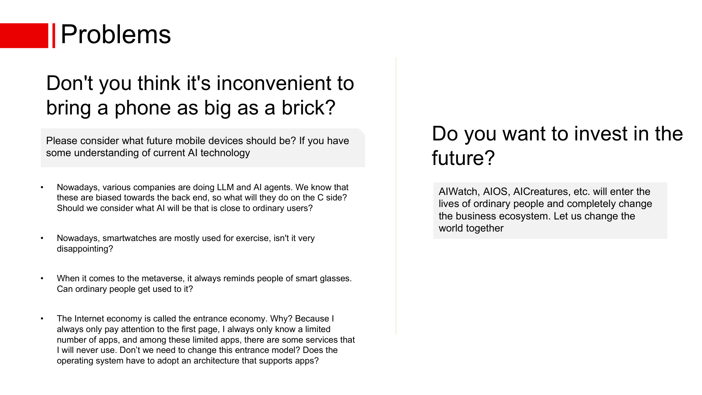](assets/page-02.png)

## 原第 3 页 · Solution

[本页文字](TRANSCRIPT.md#page-03) · [查看原尺寸图片](assets/page-03.png)

[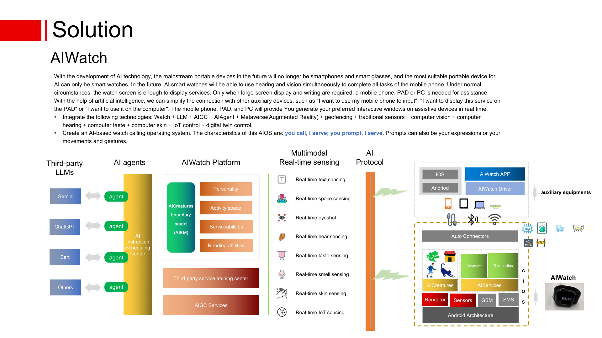](assets/page-03.png)

## 原第 4 页 · Description

[本页文字](TRANSCRIPT.md#page-04) · [查看原尺寸图片](assets/page-04.png)

[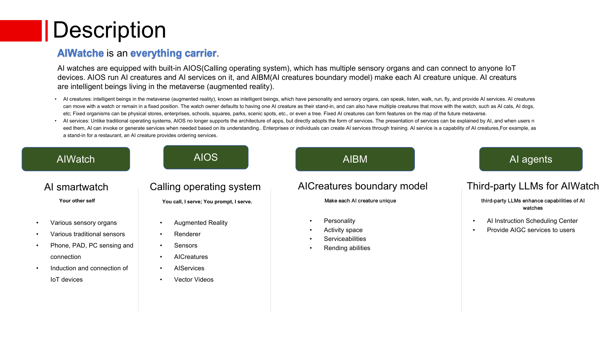](assets/page-04.png)

## 原第 5 页 · AIWatch Prototype

[本页文字](TRANSCRIPT.md#page-05) · [查看原尺寸图片](assets/page-05.png)

[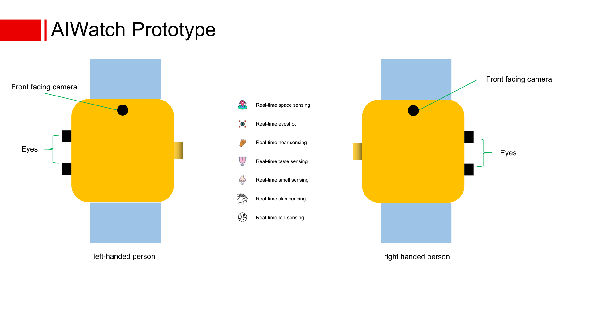](assets/page-05.png)

## 原第 6 页 · Future World — Strange dishes / Encountered Love

[本页文字](TRANSCRIPT.md#page-06) · [查看原尺寸图片](assets/page-06.png)

[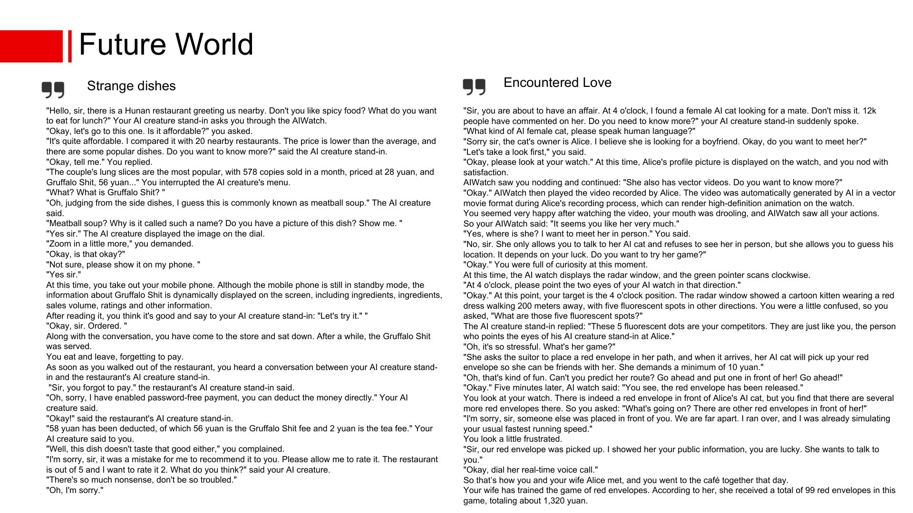](assets/page-06.png)

## 原第 7 页 · Future World — My straw weaving factory / In the AI creature Cafe

[本页文字](TRANSCRIPT.md#page-07) · [查看原尺寸图片](assets/page-07.png)

[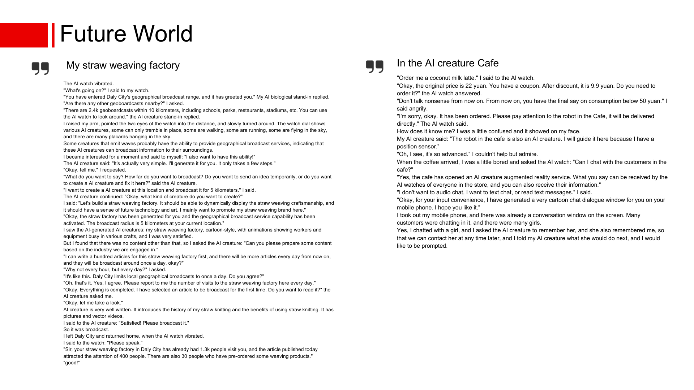](assets/page-07.png)

## 原第 8 页 · Future World — Air conditioned room / My car

[本页文字](TRANSCRIPT.md#page-08) · [查看原尺寸图片](assets/page-08.png)

[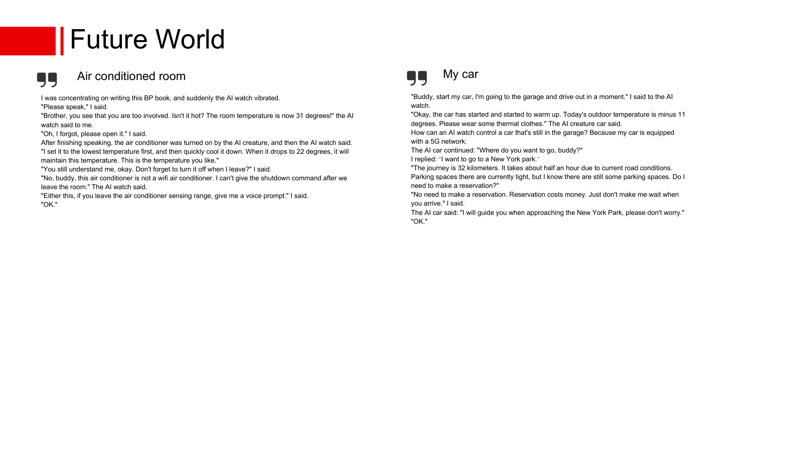](assets/page-08.png)

## 原第 9 页 · Product Positioning

[本页文字](TRANSCRIPT.md#page-09) · [查看原尺寸图片](assets/page-09.png)

[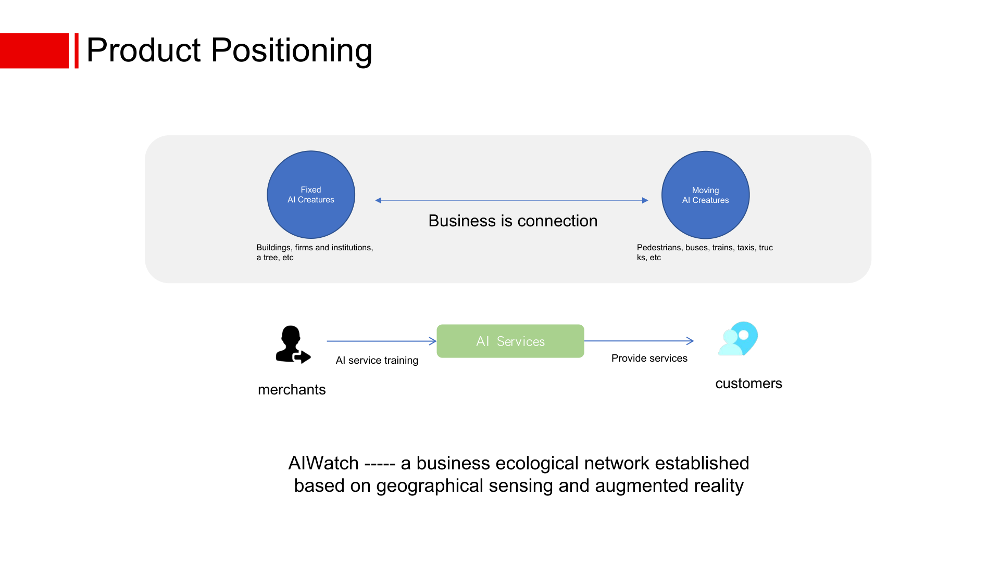](assets/page-09.png)

## 原第 10 页 · AIWatch Ecology

[本页文字](TRANSCRIPT.md#page-10) · [查看原尺寸图片](assets/page-10.png)

[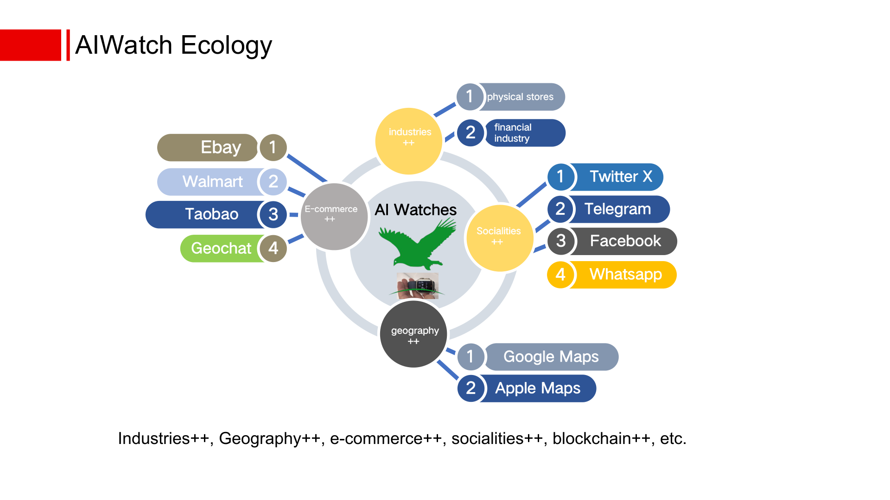](assets/page-10.png)

## 原第 11 页 · Business Model

[本页文字](TRANSCRIPT.md#page-11) · [查看原尺寸图片](assets/page-11.png)

[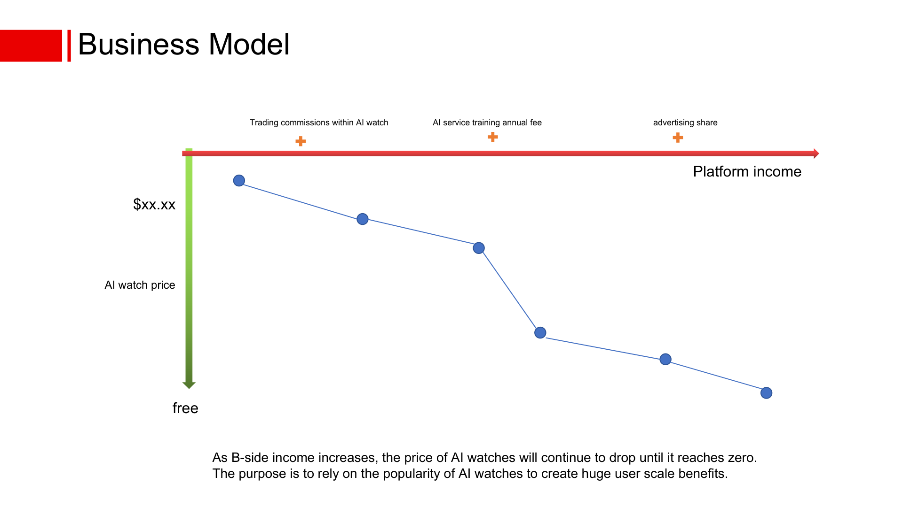](assets/page-11.png)

## 原第 13 页 · Financing Needs

[本页文字](TRANSCRIPT.md#page-13) · [查看原尺寸图片](assets/page-13.png)

[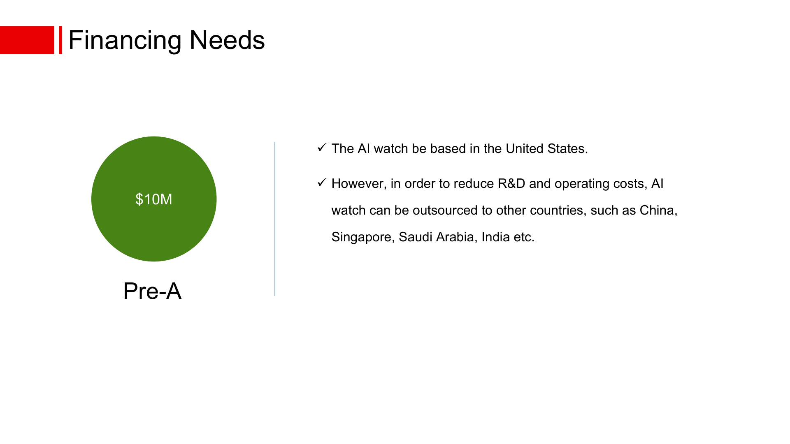](assets/page-13.png)

## 原第 14 页 · Thanks

[本页文字](TRANSCRIPT.md#page-14) · [查看原尺寸图片](assets/page-14.png)

