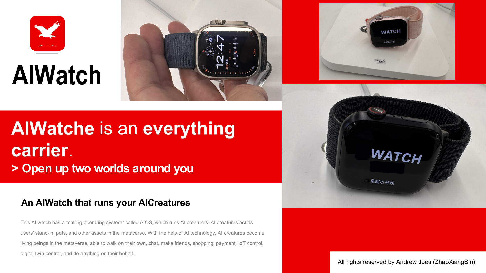

# AIWatch BP v1.0

由 `AIWatch-BP-v1.0.pdf` 转换的公开阅读版。沿用地微 BP 的「逐页原貌图片 + 原文转录」格式，保留架构图、图示、六个应用场景及原始英文措辞。

- [图文阅读版](BP.md)：13 个保留页面，点击图片可查看大图。
- [原文转录版](TRANSCRIPT.md)：可搜索、引用的逐页文字。
- [转换核验记录](conversion-report.json)：源文件校验值、页码和公开处理范围。

## 公开处理说明

- 原第 12 页创始人介绍整页排除，图片与转录均不包含该页。
- 保留页面的个人姓名／邮箱斜向水印已从内容流移除；原第 14 页的个人联系方式已移除。
- 原文中的产品名称、拼写、语法和案例叙述不作润色或翻译。封面原有版权署名保留。
- 原始 PDF 不公开上传。继续使用原页码，因此第 11 页后直接到第 13 页。
- BP 是原始产品构想和商业计划，不代表其中功能已经实现，也不代表第三方厂商已建立合作。

## 目录

- [原第 1 页 · AIWatch](BP.md#page-01)
- [原第 2 页 · Problems](BP.md#page-02)
- [原第 3 页 · Solution](BP.md#page-03)
- [原第 4 页 · Description](BP.md#page-04)
- [原第 5 页 · AIWatch Prototype](BP.md#page-05)
- [原第 6 页 · Future World — Strange dishes / Encountered Love](BP.md#page-06)
- [原第 7 页 · Future World — My straw weaving factory / In the AI creature Cafe](BP.md#page-07)
- [原第 8 页 · Future World — Air conditioned room / My car](BP.md#page-08)
- [原第 9 页 · Product Positioning](BP.md#page-09)
- [原第 10 页 · AIWatch Ecology](BP.md#page-10)
- [原第 11 页 · Business Model](BP.md#page-11)
- [原第 13 页 · Financing Needs](BP.md#page-13)
- [原第 14 页 · Thanks](BP.md#page-14)

